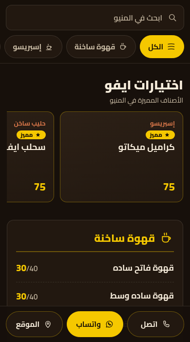
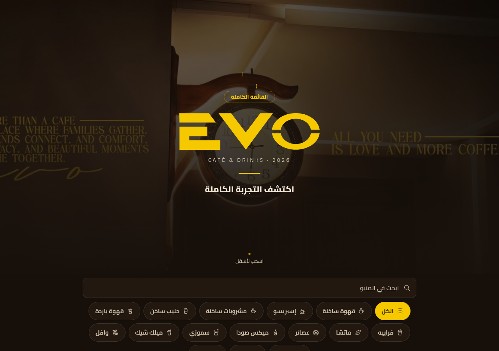

# EVO Cafe Menu

Arabic (RTL) digital menu with WhatsApp ordering for **EVO Cafe**, Mit Ghamr, Egypt. Built for a real client: customers scan a QR code, browse the menu on their phone, add items to an order and send it to the cafe on WhatsApp with their table or room number.

**Live (previous version):** https://evo-caffe-menu.vercel.app/

| Mobile home | Menu and cart | Order sheet |
|---|---|---|
|  |  |  |

Item detail, order details and success screen: `docs/mobile-item-detail.png`, `docs/mobile-order-details.png`, `docs/mobile-order-done.png`.

| Featured items | Desktop |
|---|---|
|  |  |

Note: the screenshots with the contact bar use sample contact values for the demo, not real ones.

## Features
- 15 categories plus an "All" view (170 items), prices and descriptions in Arabic
- Sticky category pills with hand-drawn SVG icons, search across all items (ignores Arabic diacritics and أ/ا, ة/ه, ى/ي)
- "اختيارات ايفو" featured strip and a "مميز" badge, both driven by items marked as highlighted in `index.html`
- WhatsApp ordering in two steps: review the cart (quantity and a note per item), then table or room number (required), optional name and note. A success screen follows. Orders also go straight to a Telegram group through a small serverless function (`api/order.js`, bot token and group id kept in Vercel environment variables); if that fails the customer gets a WhatsApp button. The Arabic message carries items, notes, name and total. Tapping an item opens a detail sheet (size, quantity, note). Nothing is stored on a server; the cart stays on the phone.
- Contact bar and footer buttons (call, WhatsApp, map, Instagram, Facebook, TikTok) that show only when a value is set in the config
- Print mode (light, two columns) with a QR code, share preview (Open Graph)
- Hero with slow background drift and steam animation (off for reduced-motion), no JS libraries, small page

## Architecture
Feature-based, plain HTML, CSS and JavaScript. No build step.
```
index.html                 menu content (single source of items and prices)
shared/                    tokens.css (all colors), base.css, print.css
features/hero/             hero.css
features/nav/              nav.css, nav.js (category tabs)
features/menu/             menu.css, menu.js (All view, featured, badges, search), photos.config.js
features/cart/             cart.css, cart.js (WhatsApp order)
features/contact/          contact.config.js (edit here), contact.js, contact.css
features/footer/           footer.css
assets/                    qr-menu.svg, photos/ (optional)
docs/                      README screenshots
```

## How to edit
- **Prices or items:** edit the category sections in `index.html`. The "All" tab is generated from them, so edit once.
- **Phone, hours, social links, WhatsApp number:** `features/contact/contact.config.js`. The WhatsApp number also receives the orders.
- **Colors:** `shared/tokens.css`.
- **Category photos:** put files in `assets/photos/` and list them in `features/menu/photos.config.js`.

## Run locally
Open `index.html` in a browser. No install, no build.

## What is done
- [x] Redesign: espresso and cream palette with the EVO logo yellow, larger readable type
- [x] Single source of prices (two differing prices resolved with the owner: higher price kept)
- [x] Icons, search, featured items, print mode and QR
- [x] WhatsApp cart with required table or room number
- [x] Two-step order flow with success screen, item detail sheet
- [x] Contact configuration

## Roadmap (edit freely)
Near term
- [ ] Real photos: hero and one per category
- [x] Opening hours (AR and EN), Instagram and Facebook in the contact config
- [ ] Phone number and TikTok in the contact config
- [ ] Labels for two-price items (for example small and large)
- [ ] Test the order flow on real iOS and Android phones
- [ ] Move menu data into a JSON file and render all views from it

Medium term
- [ ] English version with a language toggle
- [ ] Out-of-stock switch per item without editing code
- [x] Notes per item and optional customer name in the order message
- [ ] Service charge line in the order message
- [ ] Order counter or kitchen view on a screen in the cafe
- [ ] Analytics for most viewed and most ordered items

Longer term
- [ ] Small admin page so the owner edits prices and availability from his phone
- [ ] Online ordering with payment (Instapay or card) and order status for the customer
- [ ] Reusable template to sell the same menu and ordering system to other cafes
