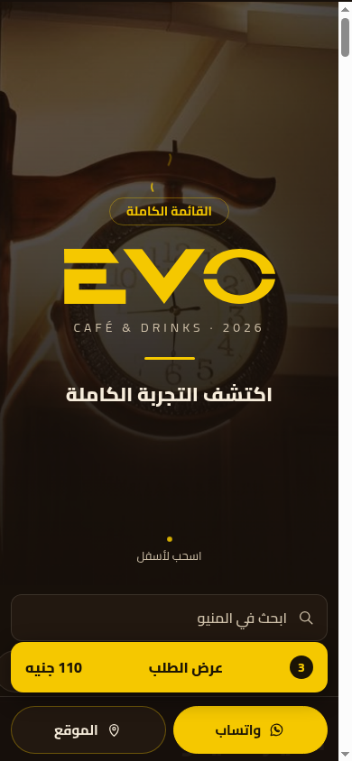
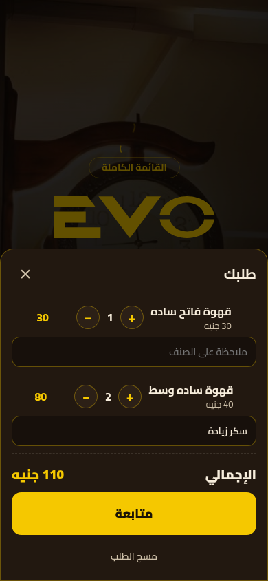

# EVO Cafe Menu

Arabic (RTL) digital menu with WhatsApp ordering for **EVO Cafe**, Mit Ghamr, Egypt. Built for a real client: customers scan a QR code, browse the menu on their phone, add items to an order and send it to the cafe on WhatsApp with their table or room number.

**Live (previous version):** https://evo-caffe-menu.vercel.app/

| Mobile home | Menu and cart | Order sheet |
|---|---|---|
|  |  |  |

Item detail, order details and success screen: `docs/mobile-item-detail.png`, `docs/mobile-order-details.png`, `docs/mobile-order-done.png`.

| Featured items | Desktop |
|---|---|
|  |  |

Note: the screenshots with the contact bar use sample contact values for the demo, not real ones.

## Features
- 15 categories plus an "All" view (170 items), prices and descriptions in Arabic
- Sticky category pills with hand-drawn SVG icons, search across all items (ignores Arabic diacritics and أ/ا, ة/ه, ى/ي)
- "اختيارات ايفو" featured strip and a "مميز" badge, both driven by items marked as highlighted in `index.html`
- WhatsApp ordering in two steps: review the cart (quantity and a note per item), then table or room number (required), optional name and note. A success screen follows. Orders also go straight to a Telegram group through a small serverless function (`api/order.js`, bot token and group id kept in Vercel environment variables); if that fails the customer gets a WhatsApp button. The Arabic message carries items, notes, name and total. Tapping an item opens a detail sheet (size, quantity, note). Nothing is stored on a server; the cart stays on the phone.
- Contact bar and footer buttons (call, WhatsApp, map, Instagram, Facebook, TikTok) that show only when a value is set in the config
- Print mode (light, two columns) with a QR code, share preview (Open Graph)
- Hero with slow background drift and steam animation (off for reduced-motion), no JS libraries, small page

## Architecture
Feature-based, plain HTML, CSS and JavaScript. No build step.
```
index.html                 menu content (single source of items and prices)
shared/                    tokens.css (all colors), base.css, print.css
features/hero/             hero.css
features/nav/              nav.css, nav.js (category tabs)
features/menu/             menu.css, menu.js (All view, featured, badges, search), photos.config.js
features/cart/             cart.css, cart.js (WhatsApp order)
features/contact/          contact.config.js (edit here), contact.js, contact.css
features/footer/           footer.css
assets/                    qr-menu.svg, photos/ (optional)
docs/                      README screenshots
```

## How to edit
- **Prices or items:** edit the category sections in `index.html`. The "All" tab is generated from them, so edit once.
- **Phone, hours, social links, WhatsApp number:** `features/contact/contact.config.js`. The WhatsApp number also receives the orders.
- **Colors:** `shared/tokens.css`.
- **Category photos:** put files in `assets/photos/` and list them in `features/menu/photos.config.js`.

## Run locally
Open `index.html` in a browser. No install, no build.

## What is done
- [x] Redesign: espresso and cream palette with the EVO logo yellow, larger readable type
- [x] Single source of prices (two differing prices resolved with the owner: higher price kept)
- [x] Icons, search, featured items, print mode and QR
- [x] WhatsApp cart with required table or room number
- [x] Two-step order flow with success screen, item detail sheet
- [x] Contact configuration

## Roadmap (edit freely)
Near term
- [ ] Real photos: hero and one per category
- [x] Opening hours (AR and EN), Instagram and Facebook in the contact config
- [ ] Phone number and TikTok in the contact config
- [ ] Labels for two-price items (for example small and large)
- [ ] Test the order flow on real iOS and Android phones
- [ ] Move menu data into a JSON file and render all views from it

Medium term
- [ ] English version with a language toggle
- [ ] Out-of-stock switch per item without editing code
- [x] Notes per item and optional customer name in the order message
- [ ] Service charge line in the order message
- [ ] Order counter or kitchen view on a screen in the cafe
- [ ] Analytics for most viewed and most ordered items

Longer term
- [ ] Small admin page so the owner edits prices and availability from his phone
- [ ] Online ordering with payment (Instapay or card) and order status for the customer
- [ ] Reusable template to sell the same menu and ordering system to other cafes

## Scale-up (branch `scale-up`)

Building on a separate branch; `main` and the live site stay untouched. Preview deploy comes from Vercel automatically.

- [x] Milestone 1 code: admin dashboard (`/admin`) to edit prices and mark items out of stock or hidden; overrides stored in Supabase (`db/001_menu_overrides.sql`), applied on the menu at load (`features/data/`). Static menu keeps working if the backend is unreachable.
- [x] Milestone 2 code: customer-visible order status (accepted / preparing / ready). Staff tap inline buttons under the Telegram order message (`api/telegram.js` webhook); the customer follows along on `order.html`. Key-gated RPCs in `db/002_orders.sql`.
- [x] Milestone 3 code: PS room booking. Staff tab in `/admin` with start/stop sessions, live timer and per-minute price calc (`db/003_rooms.sql`; edit seeded room names/rates there).
- [x] Rooms v2 (`db/004_rooms_v2.sql`): PS4 (فور) / PS5 (فايف) room types with an editable rate matrix (type × 2 or 4 controllers), switching controllers mid-session billed per time segment, menu orders placed from a room added to its open session bill (customer picks غرفة + room code), staff can add menu items to a session manually (and remove wrong ones), discount and service charge (amount or percent) on the bill, advance payment (deposit) recorded in the shift that receives it, and a close bill showing time + items + discount/service = total, less deposit = remaining. Shifts: open/close in `/admin`; a session's bill is booked to the shift that closes it; shift close is blocked while open sessions are neither closed nor explicitly carried over; the closed shift report freezes totals (time, items, discounts, service, deposits, remainders) plus the carried-over sessions with what they accrued at handover.
- [x] Rooms v3 (`db/005_rooms_v3.sql`): voiding an item on a session needs a reason (the item stays on the bill as struck-through, not billed), pause/resume a session (no time is billed while paused), an audit log of session actions (start, close, items added or voided with reason, deposit, carry-over, pause/resume, controller changes, who did it) shown from the shift bar. Billing stays by the exact minute, no rounding and no minimum. Receipts: after closing a room bill (and per order in the new "الطلبات" admin tab) "اطبع الإيصال" opens an 80mm receipt (EVO header, time, items, discount, service, deposit, total) and prints it through the browser print dialog; pick the cashier printer there.

Setup notes for the owner:
1. Run `db/001_menu_overrides.sql`, then `db/002_orders.sql`, then `db/003_rooms.sql`, then `db/004_rooms_v2.sql`, then `db/005_rooms_v3.sql`, then `db/006_staff_lock.sql` in the Supabase SQL editor (do not re-run 004 after 005). 006 makes only the emails in `staff_emails` count as staff (edit the insert for your admin email), and gates `attach_order_to_room` behind a server-side secret: after running 006, seed it once with `insert into app_secrets (name, hash) values ('room_attach', encode(sha256(convert_to(encode(sha256(convert_to('room-attach|' || '<TELEGRAM_BOT_TOKEN>', 'utf8')), 'hex'), 'utf8')), 'hex')) on conflict (name) do update set hash = excluded.hash;` (it must be re-seeded if the bot token changes). Also consider turning off public sign-ups in Supabase Auth settings.
2. Put the project URL + anon key in `features/data/data.config.js` and in `api/order.js` / `api/telegram.js` (`SUPA_URL` / `SUPA_KEY`). The anon key is public by design; RLS and the per-order key protect the data.
3. Create the admin user in Supabase Authentication (email + password). Its password lives in the password vault.
4. Register the Telegram webhook once: `https://api.telegram.org/bot<TOKEN>/setWebhook?url=https://<this-deployment>/api/telegram` (re-point to the production URL after merging).

## Admin, rooms and billing (branch `scale-up`)
Staff app at `/admin/` (Supabase Auth + Postgres, Vercel serverless, free tiers).

### Features
- Roles: admin (full) and cashier/staff (rooms, sessions, items, void with a required reason). Cashier permissions: Settings > "صلاحيات الكاشير" turns each cashier action on/off (start session, pause/resume, switch فردي/زوجي, VIP, void, add items, deposit, carry over to next shift, close and bill, open/close shift). Enforced in the database (RPC guards and an RLS policy), buttons are disabled in the UI, every change is recorded in `settings_audit` with who changed it. Default: everything allowed. Staff sign in with a username; admin creates, disables, resets and deletes staff from the "الموظفين" tab.
- Room cards: start row with rate selector, live timer and total, pause/resume, switch فردي/زوجي, VIP checkbox, add items, close bill, receipt. Billing is by the exact minute (no rounding, no minimum).
- VIP: separate hourly price matrix (room type x فردي/زوجي), editable by admin. Can be ticked mid-session. Setting "reprice elapsed time on change": whole session at the new price (default) or new price from now on (new segment). The same rule applies to فردي/زوجي changes. Every change is audited with the actor and old/new totals.
- Audit log of voids, price changes, VIP and controller switches. Orders from the customer menu post to Telegram.
- Offline mode: offline banner, cached rooms, closes queued in the browser and synced on reconnect with conflict handling, manual summary button, service worker (`admin/sw.js`).

### Setup
1. Create a Supabase project, run `db/*.sql` in order in the SQL editor (001 to 013 for a new project; an existing project that has 001 to 005 needs 006 onward).
2. Put the project URL and publishable key in the admin config. Create the admin user in Supabase Auth and add it to `staff_emails`/roles per `007`.
3. Vercel env vars: `TELEGRAM_BOT_TOKEN`, `TELEGRAM_CHAT_ID`; register the Telegram webhook to the deployment you want.
4. Never commit secrets. Passwords are typed in the panel only.

### Migrations from 006
| File | Adds |
|---|---|
| 006_staff_lock | locks tables to staff only |
| 007_staff_roles | admin/staff roles, staff management functions |
| 008_settings | white-label `app_settings` (brand, theme, direction, currency, receipt, room types, shifts, labels) |
| 009_offline_close | `close_room_session` with client end time |
| 010_vip | VIP rates, segments and rooms; `set_session_vip` |
| 011_reprice | reprice mode setting, `session_time_cost`, totals in audit |
| 012_menu | customer menu tables (`menu_categories`, `menu_items`), seeded from the static page, public read, admin write |
| 013_cashier_perms | per-action cashier permissions (`staff_can`, `set_cashier_perms`), permission audit table |

### White-label settings (admin, "الإعدادات")
Brand name, colors/theme, text direction, currency, receipt text, room types, shifts, label swaps, فردي/زوجي names, reprice mode. One client = one Supabase project + one Vercel project.

### Customer menu from the database
`index.html` keeps the static menu as a fallback. `features/data/menu-db.js` loads categories and items from Supabase (public read), renders them, caches them in localStorage (`evo-menu-cache-v1`) so the menu still opens offline after the first visit, then loads the other scripts. Admin "المنيو" tab edits categories, items (name, description, price/s, image link, hide, out of stock, featured, order). There is no print button on the customer menu (browser print still works and prints the rendered menu; receipt printing in admin is separate). Theme colors from settings (primary, accent, background, cards, text, or a preset) apply to the menu and the admin app.

### Roadmap
- Menu photos upload (today: https image links), per-item options
- Reports by shift and cashier, CSV export
- Multi-branch option
